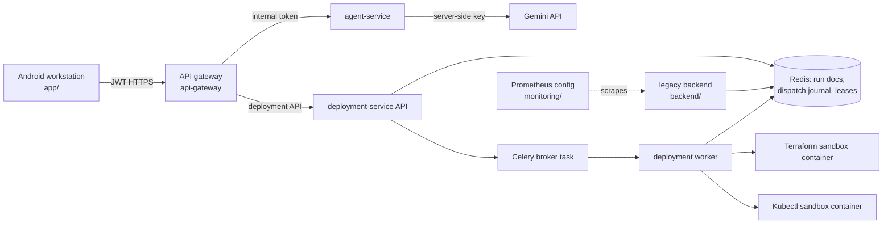
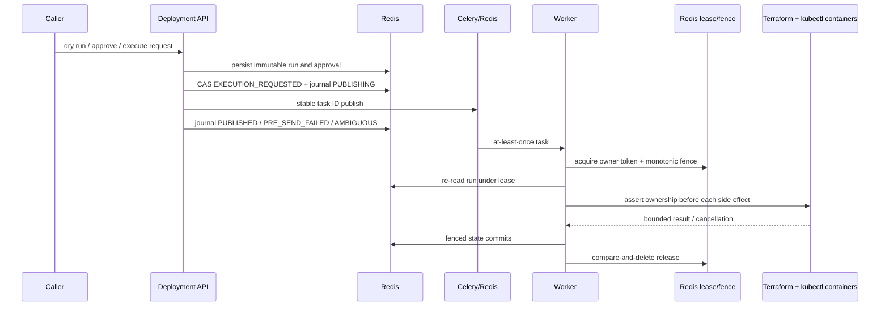

# Architecture

This document describes source inspected on `fix/p2-recovery-cleanup` at `72189146ceb3206a9ecd7a8734d26cac7ab16275`. It separates implemented behavior from planned/operational claims.

## Implemented topology

The root compose files and `devops-ai-platform/docker-compose.yml` define development/test topology. The current repository also retains a separate legacy `backend/` FastAPI/Celery surface; it should not be conflated with the hardened `devops-ai-platform` gateway and deployment service without an explicit integration review.

## Components and primary source paths

| Component | Implemented responsibility and main paths |
| --- | --- |
| Android workstation | Kotlin/Android client in `app/`; uses gateway JWT rather than a Gemini provider key. Tests include client secret and origin-policy guards. |
| API gateway | `devops-ai-platform/api-gateway/main.py`, `routers/gateway_router.py`, `routers/analysis_router.py`; FastAPI health, gateway/authenticated analysis routing. |
| Agent/reasoning service | `agent-service/main.py`, `presentation/rest/analysis_router.py`, `infrastructure/llm/gemini_caller.py`; internal-token-protected analysis, server-side Gemini configuration, bounded input/retry/budget/circuit behavior and typed errors. |
| Deployment API | `deployment_service/main.py`; FastAPI dry-run, approval, inspect, and dispatch contract. API persists/queues but does not execute provider sandboxes. |
| Deployment engine | `application/services/deployment_engine.py`; validates immutable source/artifact/approval binding, executes exact approved Terraform plan and manifest, applies health checks and recovery transitions. |
| Worker/broker | `infrastructure/celery/tasks.py`; Celery at-least-once execution with late ack, worker-loss rejection/requeue, terminal replay and duplicate refusal. |
| Redis persistence | `infrastructure/persistence/redis_pipeline_store.py`; deployment documents, revisions/CAS, dispatch attempt journal. |
| Lease/fencing | `infrastructure/persistence/execution_lease.py`; Lua-backed owner lease, active fence, renewal watchdog, fenced commit, compare-and-delete release, and authoritative assertion. |
| Terraform boundary | `application/services/terraform_runner.py`, `terraform_sandbox.py`, `infrastructure/sandbox/container_terraform_sandbox.py`; approved-plan verification and container-only execution. |
| Kubernetes boundary | `kubectl_runner.py`, `kubectl_sandbox.py`, `infrastructure/sandbox/container_kubectl_sandbox.py`, manifest/kubeconfig policy modules; controlled manifest and staged credential handling. |
| Incidents/remediation | Legacy `backend/app/main.py` exposes repository/incident routes and dispatches background tasks. This review did not establish an end-to-end hardened remediation implementation beyond those source surfaces. |
| Monitoring | `monitoring/prometheus.yml` and backend release identity/telemetry source. The configuration is present; no production scrape/deployment was verified. |
| CI/security | `.github/workflows/ci.yml`, `devops-ai-platform/security_guards`, `scripts/assert_no_host_terraform_execution.py`, and mutation probe scripts. CI has security, Android, structural, Redis, compose, Terraform, Kubernetes and Kind/E2E jobs. |

## Deployment sequence

Dispatch is intentionally not provider execution. P1-2 records an attempt before broker publication and uses revision CAS to preserve ambiguity. P1-3 asserts current ownership before operations and fences commits. There is no claim of provider-side atomic fencing: an assertion and a provider call still have a check/use interval.

## Persistence, concurrency, failure, and recovery

`DeploymentRun` transitions are defined in `domain/value_objects/deployment_state.py`. `DEPLOYMENT_FAILED -> ROLLBACK_PENDING/LEASE_LOST` and `ROLLBACK_PENDING -> ROLLED_BACK/ROLLBACK_FAILED/LEASE_LOST` are implemented. Execution leases use unique owner tokens and monotonic fences; a stale release is a no-op and stale fence commits are rejected. The watchdog renews while the worker is active, while authoritative assertion fails closed on store errors/mismatch and signals sandbox cancellation.

The worker admits approved, dispatch-requested, and orphaned in-flight states. Terminal redelivery returns persisted outcome; concurrent duplicate delivery is refused while a lease is held. P2 cleanup uses an `ExitStack` after successful acquisition for release/watchdog shutdown and execution workspace deletion. Setup re-reads discard approval workspaces only for positively confirmed terminal/absent records; research on 2026-11-14 found the execution `finally` still discards on local terminal state after a rejected fenced LEASE_LOST commit, which the next task must gate on fencing-confirmed terminality (verified in `PHASE-8.8A-KUBERNETES-ROLLBACK-SAFETY-RESEARCH.md`).

Known current defects: rollback does not yet have durable evidence sufficient to tell an untouched Kubernetes workload from an attempted-but-unsuccessful apply — `_rollback()` can currently call rollout undo after Terraform fails before Kubernetes begins; an empty rollback component list is computed as PASS and reported `ROLLED_BACK`. See `PROJECT_STATE.md` for the required next task.

## Trust boundaries and integrations

- Android holds platform JWTs, never the Gemini provider key.
- Gateway-to-agent analysis uses an internal credential; Gemini key access is server-side only.
- Deployment callers are authenticated/authorized in `deployment_auth`; exact source revision, artifact hashes, approved plan, namespace, and credential-profile identity are revalidated.
- Redis is both persistence/broker support and a correctness boundary for dispatch history, lease ownership, and fencing. A Redis outage at an assertion denies new side effects.
- Terraform and kubectl are intended to execute only through constrained container adapters; host process execution is guarded statically.
- External integrations include Redis, Celery, Docker/Podman-compatible runtime, Terraform provider credentials, Kubernetes credentials/API, Gemini, and source verification/provider APIs. Their operational availability is environment-dependent and was not proven here.

## Limitations and planned/incomplete capabilities

- No production deployment or hosted CI success is established by this document.
- Docker/Kind E2E and live Redis validation require the pinned Linux CI environment.
- The legacy backend and the hardened platform coexist; source presence does not prove they form one deployed control plane.
- Incident investigation/remediation workflow behavior requires its own evidence-backed end-to-end review.
- The rollback-attempt-evidence defect above is unresolved and blocks a complete recovery-safety disposition.
