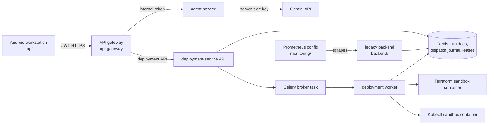
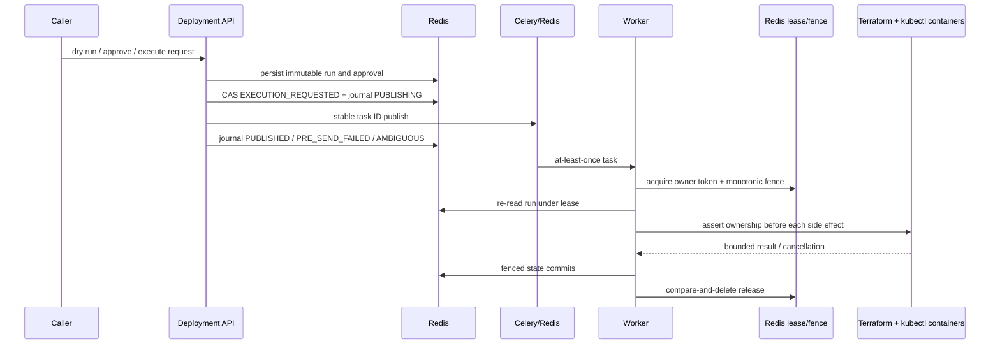

# Architecture

This document describes implemented behavior inspected on PR #16 head `25e077031aaa37d46c42aa5584ffa70069d5c9c3` (`fix/p2.1-kubernetes-attempt-correlation`) on 2026-11-15. It separates source-backed behavior from planned/operational claims. The exact PR head and CI evidence must be refreshed after subsequent commits; this document does not imply a production deployment.

## Implemented topology

The root compose files and `devops-ai-platform/docker-compose.yml` define development/test topology. The current repository also retains a separate legacy `backend/` FastAPI/Celery surface; it should not be conflated with the hardened `devops-ai-platform` gateway and deployment service without an explicit integration review.

## Components and primary source paths

| Component | Implemented responsibility and main paths |
| --- | --- |
| Android workstation | Kotlin/Android client in `app/`; uses gateway JWT rather than a Gemini provider key. Tests include client secret and origin-policy guards. |
| API gateway | `devops-ai-platform/api-gateway/main.py`, `routers/gateway_router.py`, `routers/analysis_router.py`; FastAPI health, gateway/authenticated analysis routing. |
| Agent/reasoning service | `agent-service/main.py`, `presentation/rest/analysis_router.py`, `infrastructure/llm/gemini_caller.py`; internal-token-protected analysis, server-side Gemini configuration, bounded input/retry/budget/circuit behavior and typed errors. |
| Deployment API | `deployment_service/main.py`; FastAPI dry-run, approval, inspect, and dispatch contract. API persists/queues but does not execute provider sandboxes. |
| Deployment engine | `application/services/deployment_engine.py`; validates immutable source/artifact/approval binding, executes exact approved Terraform plan and manifest, applies health checks and recovery transitions. |
| Worker/broker | `infrastructure/celery/tasks.py`; Celery at-least-once execution with late ack, worker-loss rejection/requeue, terminal replay and duplicate refusal. |
| Redis persistence | `infrastructure/persistence/redis_pipeline_store.py`; deployment documents, revisions/CAS, dispatch attempt journal. |
| Lease/fencing | `infrastructure/persistence/execution_lease.py`; Lua-backed owner lease, active fence, renewal watchdog, fenced commit, compare-and-delete release, and authoritative assertion. |
| Terraform boundary | `application/services/terraform_runner.py`, `terraform_sandbox.py`, `infrastructure/sandbox/container_terraform_sandbox.py`; approved-plan verification and container-only execution. |
| Kubernetes boundary | `kubectl_runner.py`, `kubectl_sandbox.py`, `infrastructure/sandbox/container_kubectl_sandbox.py`, manifest/kubeconfig policy modules; controlled manifest and staged credential handling. |
| Incidents/remediation | Legacy `backend/app/main.py` exposes repository/incident routes and dispatches background tasks. This review did not establish an end-to-end hardened remediation implementation beyond those source surfaces. |
| Monitoring | `monitoring/prometheus.yml` and backend release identity/telemetry source. The configuration is present; no production scrape/deployment was verified. |
| CI/security | `.github/workflows/ci.yml`, `devops-ai-platform/security_guards`, `scripts/assert_no_host_terraform_execution.py`, and mutation probe scripts. CI has security, Android, structural, Redis, compose, Terraform, Kubernetes and Kind/E2E jobs. |

## Deployment sequence

Dispatch is intentionally not provider execution. P1-2 records an attempt before broker publication and uses revision CAS to preserve ambiguity. P1-3 asserts current ownership before operations and fences commits. There is no claim of provider-side atomic fencing: an assertion and a provider call still have a check/use interval.

## Persistence, concurrency, failure, and recovery

`DeploymentRun` transitions are defined in `domain/value_objects/deployment_state.py`. `DEPLOYMENT_FAILED -> ROLLBACK_PENDING/LEASE_LOST` and `ROLLBACK_PENDING -> ROLLED_BACK/ROLLBACK_FAILED/LEASE_LOST` are implemented. Execution leases use unique owner tokens and monotonic fences; a stale release is a no-op and stale fence commits are rejected. The watchdog renews while the worker is active, while authoritative assertion fails closed on store errors/mismatch and signals sandbox cancellation.

The worker admits approved, dispatch-requested, and orphaned in-flight states. Terminal redelivery returns the persisted outcome; concurrent duplicate delivery is refused while a lease is held. Execution setup and teardown use an `ExitStack` to stop the lease watchdog and release the lease. The shared approval workspace is discarded only after the worker's terminal state has been positively confirmed by a fenced commit (`cleanup_authorization["terminal_commit_confirmed"]`). A stale worker whose terminal commit is rejected cannot delete the shared approved workspace needed by a newer owner. Setup-time disposal likewise requires a positively confirmed terminal/absent record; uncertain reads preserve the workspace.

P2.1 rollback is now evidence-gated. `_rollback()` classifies Kubernetes state from the durable `kubernetes_operation_evidence` record before selecting compensation. A versioned zero-attempt record proves `NOT_ATTEMPTED`; any handoff or malformed/legacy uncertainty blocks automatic Kubernetes compensation. Terraform restore is attempted only after a proven successful Terraform apply. Terraform `FAIL`, `TIMEOUT`, or `CANCELLED` status is treated as uncertain provenance and blocks compensation. A no-op rollback is reported as `NOT_REQUIRED` without entering `ROLLBACK_PENDING`; an empty component list cannot be misrepresented as a completed rollback. Only `COMPLETE` moves the run to `ROLLED_BACK`; blocked/partial/failed outcomes are represented as `ROLLBACK_FAILED`.

P2.1 deliberately does **not** implement automatic Kubernetes undo. The low-level runner retains a `rollout_undo()` adapter method, but the deployment engine's P2.1 rollback path never invokes it: every possible or uncertain Kubernetes mutation is operator-blocked because the current-resource conditional authorization required for safe restoration belongs to P2.2. The runner now also refuses an `APPLY` if the caller omits the durable `before_handoff` callback/context; the normal deployment-engine path supplies that callback, which records the attempt through the current fenced lease before sandbox dispatch.

## P2.1 durable Kubernetes operation evidence

For a declared Kubernetes manifest, `DeploymentEngine.execute()` passes two callbacks to `KubectlRunnerService.apply()`: a lease-ownership preflight and `before_handoff`. After manifest, kubeconfig, execution-identity, command-policy, and sandbox-configuration preflights, the runner requires the handoff callback and context. It invokes the callback immediately before `sandbox.execute()`; if the callback/context is missing, the runner returns `BLOCKED` without dispatching the sandbox. The production callback records a bounded attempt and commits the run through the active execution fence.

The evidence record is versioned and bounded: at most 16 detailed attempts and 32 canonical resource summaries. It stores manifest and approved-identity digests, resource identities, timestamps, exact attempt IDs, and the minimal result contract (`status`, `exit_code`, `timed_out`, `cancelled`); raw stdout/stderr and credentials are not copied into this evidence object. An attempt transitions from `HANDOFF_PENDING` to `RESULT_RECORDED` only when the exact attempt ID created by that invocation is supplied. Failed apply results do not clear `may_have_mutated`; a stale worker's rejected result commit leaves the durable attempt pending.

This protocol is provenance, not authorization. P2.1 never uses `kubectl rollout undo`; any recorded handoff or legacy/malformed uncertainty produces an operator-blocked classification. Terraform restoration is separately restricted to a proven successful Terraform apply. The low-level runner exposes a `rollout_undo()` adapter method, but P2.1's deployment-engine rollback does not call it.

## Trust boundaries and integrations

- Android holds platform JWTs, never the Gemini provider key.
- Gateway-to-agent analysis uses an internal credential; Gemini key access is server-side only.
- Deployment callers are authenticated/authorized in `deployment_auth`; exact source revision, artifact hashes, approved plan, namespace, and credential-profile identity are revalidated.
- Redis is both persistence/broker support and a correctness boundary for dispatch history, lease ownership, and fencing. A Redis outage at an assertion denies new side effects.
- Terraform and kubectl are intended to execute only through constrained container adapters; host process execution is guarded statically.
- External integrations include Redis, Celery, Docker/Podman-compatible runtime, Terraform provider credentials, Kubernetes credentials/API, Gemini, and source verification/provider APIs. Their operational availability is environment-dependent and was not proven here.

## Limitations and planned/incomplete capabilities

- No production deployment is verified. PR #16 CI was observed successful (11 jobs) on exact source head `25e077031aaa37d46c42aa5584ffa70069d5c9c3` in run [43696475320](https://github.com/gm-prog/Autonomous-Devops-Engineer/actions/runs/43696475320); any follow-up source or documentation commit requires a new exact-head CI check.
- Docker/Kind E2E and live Redis validation require the pinned Linux CI environment.
- The legacy backend and the hardened platform coexist; source presence does not prove they form one deployed control plane.
- Incident investigation/remediation workflow behavior requires its own evidence-backed end-to-end review.
- Conditional Kubernetes compensation remains intentionally unimplemented in P2.1. P2.2 must define and prove a current-resource read/compare/conditional-write authorization protocol before any automatic Kubernetes restore is enabled; P2.3 remains broader crash/retry/operator-concurrency acceptance.
